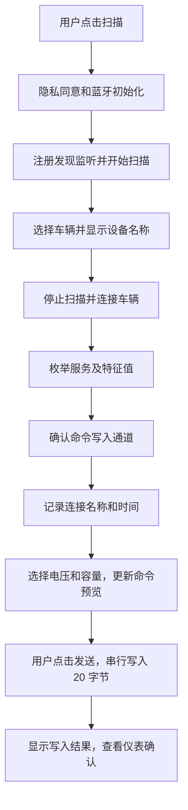

# 小牛电压切换助手：微信小程序开发与 iPhone 使用操作文档

核对日期：2026-10-19。现有页面是本仓库的 `niubule.html`，线上地址为 <https://djangonvme.github.io/niu/niubule.html>；本文中的迁移对象均指这个文件。

## 1. 可行性结论

**可以做成微信小程序。iPhone 微信支持通过原生小程序 BLE 接口扫描车辆、建立连接、获取 GATT 服务及特征值，并向可写特征值发送二进制命令。**

微信官方明确支持 iOS 的 BLE 主机模式，提供了完整的连接、发现服务和写入流程。现有网页使用的也是 BLE/GATT，通信模型一致。原命令是 20 字节，符合微信官方在 MTU 未知时建议的单次传输大小。[官方 BLE 指南](https://developers.weixin.qq.com/miniprogram/dev/framework/device/ble.html)、[官方写入接口](https://developers.weixin.qq.com/miniprogram/dev/api/device/bluetooth-ble/wx.writeBLECharacteristicValue.html)。

需要区分平台能力和车辆验证结果：

| 项目 | 当前结论 |
| --- | --- |
| iPhone 微信小程序支持 BLE 扫描、连接和写入 | 已核对官方文档，支持 |
| 复现现有页面的设备选择、历史记录、电压/容量选择和命令预览 | 可以，用小程序页面组件实现 |
| 复用现有 20 字节组包格式 | 可以，发送时传入 `ArrayBuffer` |
| 车辆实际使用的服务 UUID、特征 UUID、写入方式 | 需要连接车辆枚举并确认；网页目前没有固定写入特征 UUID |
| 微信向这辆车发送后确实完成电压切换 | 尚未实测，需要按第 10 节验证 |

如果同一辆车已经能通过 Bluefy 接收这条命令，这是迁移的有利依据；仍需验证微信侧的权限、GATT 通道和车辆响应。可导入的工程已放在 [`miniprogram/`](miniprogram/)，快速使用步骤见 [工程 README](miniprogram/README.md)。

## 直接使用本仓库工程

1. 在微信开发者工具选择“导入项目”，目录选择本仓库的 `miniprogram/`，不要选择仓库根目录。
2. 将项目中的 `touristappid` 占位值替换为自己的小程序 AppID；导入界面也可直接填写自己的 AppID。无需 AppSecret。
3. 选择“不使用云服务”和稳定基础库（至少 2.32.3），直接编译，不需要安装依赖或构建 npm。
4. 在小程序后台的隐私保护指引中声明“访问你的蓝牙”。
5. 用开发者微信在 iPhone 上扫码预览，完成授权后扫描、连接车辆并验证命令。
6. 验证通过后上传为体验版；完整流程见第 9 节。

工程已包含页面、蓝牙控制、通道选择、命令预览、本地历史记录、前后台清理和模拟测试。`niubule.html` 不参与小程序的运行和打包。

## 2. 界面和实现方式

采用原生微信小程序：WXML + WXSS + JavaScript。把现有界面重建成小程序页面，蓝牙功能使用 `wx.*` API。

页面从上到下保留以下内容：

1. 上次成功连接的蓝牙名称、连接时间。
2. 当前已选蓝牙名称和连接状态。
3. 扫描按钮、车辆选择器、停止扫描入口。
4. 电压选择：48V、60V、72V。
5. 容量选择：沿用网页的八个选项。
6. 待发送配置和完整的 20 字节 HEX 命令。
7. 发送按钮及页面内操作结果。
8. 清除本小程序连接记录入口。

不采用 `<web-view src="https://djangonvme.github.io/niu/niubule.html">` 直接套网页的方案。网页中的 `navigator.bluetooth` 不会自动变成微信原生蓝牙调用；`web-view` 可用的网页接口也不是完整的小程序 API。此外，官方当前说明个人类型小程序不支持 `web-view`。[官方 web-view 文档](https://developers.weixin.qq.com/miniprogram/dev/component/web-view.html)。

这个版本可以把页面、命令映射和历史记录全部放在小程序本地，不需要自建服务器、数据库、云开发或请求 GitHub Pages。小程序代码包下载、更新和平台相关操作仍可能需要网络；车辆扫描及命令传输走蓝牙。使用微信后无需经过 Bluefy，但不能据此承诺 iOS 或微信永远不会出现网络、隐私或蓝牙权限提示。

## 3. 账号与开发工具准备

### 3.1 注册账号并取得 AppID

1. 打开 [微信公众平台](https://mp.weixin.qq.com/)，选择注册“小程序”。
2. 按实际情况选择主体并完成注册。个人自用可以先查看个人主体可用的功能和类目。
3. 登录小程序管理后台，在“开发管理 / 开发设置”等当前后台入口找到小程序 AppID；不要使用公众号的 AppID。
4. 在“成员管理”中确认用于开发和扫码的微信账号有开发者权限。
5. 初期以开发预览和体验版验证为目标；正式公开发布另按后台要求完成信息、类目、备案及审核流程。

建议用自己实际注册的小程序 AppID 做蓝牙真机验证。测试号可以用于学习建项目，但不能将其测试结果直接等同于正式账号的权限和发布条件。账号资格、费用和审核要求以注册时的后台为准。

官方入口：[创建第一个小程序](https://developers.weixin.qq.com/miniprogram/dev/framework/quickstart/getstart.html)、[成员管理与版本发布](https://developers.weixin.qq.com/miniprogram/dev/framework/quickstart/release.html)。

### 3.2 安装和导入项目

1. 安装适用于当前 Mac 的 [微信开发者工具稳定版](https://developers.weixin.qq.com/miniprogram/dev/devtools/download.html)，使用开发者微信扫码登录。
2. 选择“导入项目”，使用本仓库的 `miniprogram/` 文件夹。
3. 填写自己的 AppID，选择“不使用云服务”。项目配置中的 `touristappid` 仅为占位。
4. 选用当前微信客户端支持的稳定基础库。本方案包含 `writeType` 和隐私 API 示例，基础库至少使用 **2.32.3**；`writeType` 本身从 2.22.0 开始支持。
5. 先完成页面编译，再用 iPhone 微信扫码预览验证蓝牙。电脑模拟器显示成功不能替代 iPhone 的实际扫描和写入结果。

当前工程结构如下：

```text
miniprogram/
├── app.js
├── app.json
├── app.wxss
├── project.config.json
├── README.md
├── package.json
├── tests/              # Node.js 模拟测试，不打入小程序代码包
├── pages/
│   └── index/
│       ├── index.js
│       ├── index.json
│       ├── index.wxml
│       └── index.wxss
└── utils/
    ├── ble.js          # 蓝牙权限、扫描、连接、通道、写入和断线处理
    ├── config.js       # 候选 UUID 和超时时间
    ├── history.js      # 连接名称、时间和本地缓存
    └── protocol.js     # 电压/容量映射、20 字节组包和 HEX 预览
```

最小 `app.json` 示例：

```json
{
  "pages": ["pages/index/index"],
  "window": {
    "navigationBarTitleText": "电压切换助手",
    "navigationBarBackgroundColor": "#ffffff",
    "navigationBarTextStyle": "black",
    "backgroundColor": "#f0f2f5"
  },
  "style": "v2"
}
```

蓝牙初始化成功前，不启用连接和发送功能。这个配置本身不授予蓝牙权限；权限处理见下一节。

## 4. iPhone 蓝牙与隐私授权

需要分别处理三个层面的条件：

| 条件 | 操作 |
| --- | --- |
| iPhone 蓝牙开关和微信的系统蓝牙权限 | 打开蓝牙；首次系统询问时允许微信使用蓝牙。拒绝后，可在 iPhone“设置 → 隐私与安全性 → 蓝牙”中检查微信权限，具体入口随 iOS 版本调整 |
| 小程序蓝牙授权 `scope.bluetooth` | 在用户点击扫描时调用 `wx.openBluetoothAdapter({ mode: 'central' })`，处理首次授权或拒绝；拒绝后提供由用户点击触发的设置入口，可使用 `wx.openSetting` |
| 小程序隐私保护指引 | 在小程序后台声明“访问你的蓝牙”，说明用于发现和连接车辆并发送用户选择的电池配置 |

`scope.bluetooth` 是微信文档明确标注的蓝牙授权范围。不要照搬网页授权逻辑，也不要用 `app.json` 中虚构的权限配置代替实际授权。iPhone 侧的方案不需要主动申请地理位置；不要把某些 Android 扫描条件当成 iPhone 的必要条件。

推荐首次扫描流程：

1. 页面内说明用途：“用于查找附近车辆蓝牙并发送你选择的电池配置。”
2. 用户点击“扫描车辆”。
3. 根据官方隐私机制完成用户同意；最小版本可使用微信官方隐私弹窗，不自行接管 `wx.onNeedPrivacyAuthorization`。
4. 初始化蓝牙主机模式，成功后才开始扫描。
5. 用户拒绝时显示原因并结束本次操作，恢复按钮状态，由用户决定是否重试或打开设置。

如需要显式在初始化前完成隐私授权，可使用以下回调封装；它依赖后台正确填写隐私保护指引，不能替代后台声明：

```js
function callWx(api, options = {}) {
  return new Promise((resolve, reject) => {
    wx[api]({ ...options, success: resolve, fail: reject });
  });
}

async function prepareBluetooth() {
  // 由页面的“扫描”按钮触发，调用方捕获拒绝或初始化失败。
  await callWx('requirePrivacyAuthorize');
  await callWx('openBluetoothAdapter', { mode: 'central' });
}
```

官方依据：[初始化和蓝牙授权](https://developers.weixin.qq.com/miniprogram/dev/api/device/bluetooth/wx.openBluetoothAdapter.html)、[隐私信息与接口对应表](https://developers.weixin.qq.com/miniprogram/dev/framework/user-privacy/miniprogram-intro.html)、[隐私授权接入指南](https://developers.weixin.qq.com/miniprogram/dev/framework/user-privacy/PrivacyAuthorize.html)。

## 5. 网页功能迁移对照

| 当前网页 | 小程序实现 |
| --- | --- |
| HTML/CSS 卡片与状态区 | WXML 的 `view`、`text`、`button`，配合 WXSS |
| `<select>` | `picker mode="selector"`，通过 `bindchange` 处理选择 |
| `document.getElementById`、`textContent` | 页面 `data` 和 `this.setData()` |
| `navigator.bluetooth.requestDevice()` | 初始化、扫描、监听设备发现，由小程序自己展示车辆列表 |
| `device.gatt.connect()` | `wx.createBLEConnection()` |
| 获取服务及特征值 | `wx.getBLEDeviceServices()`、`wx.getBLEDeviceCharacteristics()` |
| `writeValueWithoutResponse()` | `wx.writeBLECharacteristicValue({ writeType: 'writeNoResponse' })` |
| `writeValue()` | `wx.writeBLECharacteristicValue({ writeType: 'write' })`，前提是支持有回复写 |
| `localStorage` | `wx.getStorageSync()`、`wx.setStorageSync()` |
| `gattserverdisconnected` | `wx.onBLEConnectionStateChange()` |
| 清除连接记忆 | `wx.removeStorageSync('niu_last_connection')`，同时清理本次连接状态 |

设备显示名称优先使用有效的 `name`，缺失时使用 `localName`，再缺失则显示未命名设备及部分标识。扫描列表按照 `deviceId` 去重，不能按名称去重；两辆车可能同名。

## 6. 原有协议和命令预览

以下字节来自现有 `niubule.html`，是对已有实现的迁移，不代表已取得车辆厂商的完整协议说明。

完整命令固定为 20 字节：

```text
67 84 85 59 11 12 76 99 61 22 92 43 23 54 45 39 87 VV AA 26
```

`VV` 为电压代码，`AA` 为容量代码，分别位于从 0 开始计数的下标 17、18。末尾 `26` 沿用网页固定值；当前代码没有提供校验算法，迁移时不要自行改成推测的校验值。

| 电压 | HEX 代码 |
| --- | --- |
| 48V | `02` |
| 60V | `03` |
| 72V | `05` |

| 电池容量 | HEX 代码 |
| --- | --- |
| 20 Ah | `01` |
| 23 Ah | `02` |
| 26 / 24 Ah | `03` |
| 32 Ah | `05` |
| 38 Ah | `06` |
| 35 Ah | `08` |
| 45 Ah | `0C` |
| 48 Ah | `07` |

默认选择为 72V / 45 Ah，对应：

```text
67 84 85 59 11 12 76 99 61 22 92 43 23 54 45 39 87 05 0C 26
```

可放入 `utils/protocol.js` 的组包示例：

```js
const VOLTAGE_CODES = ['02', '03', '05'];
const CAPACITY_CODES = ['01', '02', '03', '05', '06', '08', '0C', '07'];

function buildCommand(voltageCode, capacityCode) {
  if (!VOLTAGE_CODES.includes(voltageCode) ||
      !CAPACITY_CODES.includes(capacityCode)) {
    throw new Error('请选择有效的电压和容量');
  }
  const packet = new Uint8Array([
    0x67, 0x84, 0x85, 0x59, 0x11, 0x12, 0x76, 0x99,
    0x61, 0x22, 0x92, 0x43, 0x23, 0x54, 0x45, 0x39,
    0x87, parseInt(voltageCode, 16), parseInt(capacityCode, 16), 0x26
  ]);
  return {
    value: packet.buffer,
    hex: Array.from(packet, byte => byte.toString(16).padStart(2, '0').toUpperCase()).join(' ')
  };
}

module.exports = { buildCommand };
```

每次选择变化都调用这一函数更新界面；发送时也从当前选项调用这一函数。预览展示配置文字和 `hex`，实际写入传 `value`。不能把显示用的 HEX 字符串直接传给蓝牙，也不能当成 ASCII 文本编码后发送。

## 7. 扫描、连接和写入流程



### 7.1 扫描车辆

1. 在开始扫描前注册 `wx.onBluetoothDeviceFound`；避免重复进入页面时叠加监听。
2. 初始化成功后调用 `wx.startBluetoothDevicesDiscovery`。
3. 首次调试先不设置 `services` 过滤，在发现回调中按 `name` / `localName` 筛选 NIU 设备，名称匹配兼容大小写。
4. 原网页的 FFE0、FF00 只是请求访问的服务候选，并不能证明车辆广播包一定包含它们。扫描参数 `services` 只匹配广播中包含对应主服务 UUID 的设备，过早填写可能导致扫不到车辆。
5. 按 `deviceId` 合并列表，同名设备分别显示；用户选择后立即展示名称。
6. 扫描建议设置约 10 秒的应用层停止计时，并提供重扫。选择车辆、离开页面时停止扫描和清理计时器。

`wx.startBluetoothDevicesDiscovery` 与网页的授权服务列表含义不同，不能直接复制网页的 `optionalServices` 参数。[官方扫描接口](https://developers.weixin.qq.com/miniprogram/dev/api/device/bluetooth/wx.startBluetoothDevicesDiscovery.html)。

### 7.2 连接并确认通道

1. 切换车辆时，先等待旧设备 `wx.closeBLEConnection` 完成，清空旧写入通道。
2. 使用本次扫描所得 `deviceId` 调用 `wx.createBLEConnection`，设置合理的连接超时，例如 10 秒。
3. 顺序调用 `wx.getBLEDeviceServices`，再对相关服务调用 `wx.getBLEDeviceCharacteristics`。
4. 调试时输出服务 UUID、特征 UUID，以及 `write`、`writeDefault`、`writeNoResponse`、`notify`、`indicate` 属性。
5. 优先核对现有网页访问的服务候选：

   ```text
   0000FFE0-0000-1000-8000-00805F9B34FB
   0000FF00-0000-1000-8000-00805F9B34FB
   ```

6. 原网页取遇到的第一个可写特征，但小程序首轮适配应确认它是否是车辆的命令通道。多个候选时展示诊断信息并明确选择；验证后在配置中固定正确的服务/特征 UUID，不按枚举先后顺序猜测，也不预设特征一定叫 FFE1。
7. 连接成功且正确通道可用后，才启用发送按钮并保存“上次连接”记录。蓝牙连接成功但通道未确认时，显示“已连接，待确认写入通道”。

**iOS 必须在本次连接中实际获取过服务和特征值，然后使用返回的 UUID 写入。** 即使已经知道目标 UUID，也应先枚举再匹配；不能读取缓存 UUID 后直接跳到写入。[官方 BLE 注意事项](https://developers.weixin.qq.com/miniprogram/dev/framework/device/ble.html)。

### 7.3 选择正确的写入方式

微信的属性字段与浏览器不同：

| 微信返回属性 | 含义 | 写入参数 |
| --- | --- | --- |
| `properties.writeDefault` | 支持有回复写 | `writeType: 'write'` |
| `properties.writeNoResponse` | 支持无回复写 | `writeType: 'writeNoResponse'` |
| `properties.write` | 可写能力标记 | 结合上面两个字段、真机返回值及验证结果判断具体方式 |

当前网页在支持无回复写时优先使用它。迁移时可先验证对应模式；如果车辆通道只支持有回复写，则明确选择 `write`。两种能力都支持时，使用与该车辆验证通过的方式。仅有 `write` 而缺少细分字段时，不把它当成“两种模式都支持”的证明，应先核对微信版本和真机返回信息。

以下为通道已确认后的写入示例，与第 4 节的 `callWx` 配合使用：

```js
const { buildCommand } = require('./protocol');

async function writeConfig(channel, voltageCode, capacityCode) {
  if (!channel || !channel.deviceId || !channel.serviceId ||
      !channel.characteristicId ||
      !['write', 'writeNoResponse'].includes(channel.writeType)) {
    throw new Error('请先连接车辆并确认写入通道');
  }
  const command = buildCommand(voltageCode, capacityCode);
  await callWx('writeBLECharacteristicValue', {
    deviceId: channel.deviceId,
    serviceId: channel.serviceId,
    characteristicId: channel.characteristicId,
    writeType: channel.writeType,
    value: command.value
  });
  return command.hex;
}
```

此代码是核心调用示例，完整页面还需实现连接状态检查、发送锁、失败处理和超时处理：

- 发送前保存本次设备、配置和命令快照，锁定设备选择、电压/容量选择及发送按钮；写入结束再恢复。
- 连续点击不得产生并行写入。官方提示并行写可能失败。
- 当前命令一次发送 20 字节即可，不需要扩大 MTU 或拆包。
- 断线时立即清空可用通道，禁用发送；重新连接后重新发现服务和特征值。
- 写入超时显示“结果未知”，清理连接状态后允许用户重连并核对车辆状态；不要自动重发。超时不等于车辆没有收到。
- 回调成功显示“命令已写入，请查看仪表确认”；它不能代替车辆业务层的成功回执。

字段和模式依据：[获取特征值](https://developers.weixin.qq.com/miniprogram/dev/api/device/bluetooth-ble/wx.getBLEDeviceCharacteristics.html)、[写入二进制数据](https://developers.weixin.qq.com/miniprogram/dev/api/device/bluetooth-ble/wx.writeBLECharacteristicValue.html)。

## 8. 历史记录与页面生命周期

建议存储键仍使用 `niu_last_connection`，结构如下：

```json
{
  "name": "NIU Link 实际蓝牙名称",
  "deviceId": "微信扫描返回的设备标识",
  "connectedAt": "2026-10-19T03:20:00.000Z"
}
```

- 连接并确认通道成功后，用 `wx.setStorageSync` 保存；展示时间时转换为手机本地时间。
- 页面进入时用 `wx.getStorageSync` 恢复名称和时间。存储失败不应阻断已经可用的蓝牙连接。
- 历史记录只说明上次连接信息，不表示这次已经连接；不自动发送命令。
- Bluefy 的网页 `localStorage` 与微信小程序存储相互独立，首次使用小程序时没有网页历史记录。
- `deviceId` 是微信当前环境返回的标识，不能硬编码成车辆 MAC，也不能复用 Bluefy 的 ID。可以把历史 ID 当作重连候选，失败后回到扫描选择。
- 清除记录使用 `wx.removeStorageSync`，不要清空小程序全部缓存。
- 注册 `wx.onBLEConnectionStateChange`，仅处理当前设备的状态变化。
- `onHide` 停止扫描并禁用发送；保持前台完成操作。回到页面时核对连接状态，必要时重连，不能仅凭原有 UI 标记认为连接仍可用。
- `onUnload` 停止扫描、清理定时器，移除本页注册的监听，关闭当前 BLE 连接和本工具使用的蓝牙适配器；异步清理失败时记录结果。

当前工程在 `onHide` 也会主动释放连接，重新进入后点击“重连”或再次扫描。这样不会把前一次的连接状态误认为本次仍可发送。

## 9. iPhone 真机预览与自用体验版

### 9.1 首次预览

1. 在开发者工具点击“编译”，确认页面没有脚本或 WXML 错误。
2. 点击“预览”，使用有权限的 iPhone 微信扫码进入。
3. 让车辆处于可连接状态，靠近车辆；确认 Bluefy 和其他连接车辆的程序已释放蓝牙连接。
4. 点击扫描，完成隐私同意、小程序蓝牙授权和 iOS 的微信蓝牙授权。
5. 选中车辆，观察名称、连接进度和服务/特征诊断信息。
6. 按第 10 节完成通道确认和命令实测。

### 9.2 设置体验版，方便日常打开

1. 真机验证通过后，在开发者工具点击“上传”，填写版本号和备注，例如 `0.1.0`、`iPhone BLE 电压切换验证版`。
2. 登录小程序后台，在“版本管理 → 开发版本”找到上传记录，设置为体验版。
3. 在“成员管理”中为需要使用的人添加体验权限。
4. iPhone 微信扫描体验版二维码进入；可在微信中添加到“我的小程序”，后续从微信入口打开。
5. 后续修改通过开发者工具重新上传，再在后台更新体验版。GitHub Pages 更新不会更新小程序代码包。

体验版面向有权限的成员，适合开发验证和少量自用。正式向所有人开放时，再按小程序后台要求提交审核并发布，不能把体验版二维码等同于公开上线。后台入口名称及账号要求以实际界面为准。[官方发布流程](https://developers.weixin.qq.com/miniprogram/dev/framework/quickstart/release.html)。

### 9.3 每次使用

1. 从微信打开助手，顶部查看上次连接的车辆和时间。
2. 扫描并选择本次车辆，等待显示通道就绪。
3. 选择电压和容量，核对发送按钮上方的配置与 HEX 命令。
4. 点击发送，等待页面给出写入结果。
5. 查看车辆仪表确认实际状态，再离开页面。

## 10. 首轮真机验收

以下为待执行的验收项，不表示已经测试通过：

| 验证项 | 通过标准 |
| --- | --- |
| 首次蓝牙授权 | 同意后可扫描，拒绝后有明确提示并可由用户重试 |
| 车辆发现 | 能列出目标 NIU 蓝牙，同名设备不会被合并 |
| 已选名称 | 选择后立即显示对应设备名称 |
| GATT 发现 | 记录实际服务/特征 UUID，确定命令写入通道及写入方式 |
| 命令预览 | 3 个电压 × 8 个容量共 24 种组合，预览与组包结果一致；这一步离线完成，无需对车辆发送 24 次 |
| 默认配置 | 72V / 45 Ah 的 20 字节数据与第 6 节一致 |
| 真实写入 | 选择已确认适用的配置，写入回调成功，车辆仪表状态符合预期 |
| 车辆切换 | 旧连接已释放；发送仅指向新选择且确认就绪的车辆 |
| 历史恢复 | 关闭后重新进入，能显示上次成功连接名称与本地时间，但发送仍须等待连接 |
| 断线处理 | 关闭车辆蓝牙或远离设备后禁用发送；重连后重新获取服务/特征 |
| 发送锁 | 连点只触发一次写入；写入过程中无法切换车辆和配置 |
| 前后台切换 | 回到微信小程序时正确恢复或提示重连，不根据旧状态直接发送 |
| 存储异常 | 记录保存失败时提示，现有连接仍能使用 |

实测记录模板：

```text
测试日期：
iPhone 型号 / iOS 版本：
微信版本 / 小程序基础库版本：
车辆型号 / 蓝牙名称：
实际 serviceId：
实际 characteristicId：
write / writeDefault / writeNoResponse 属性：
实际 writeType：
发送的完整 20 字节 HEX：
微信写入回调：
车辆仪表实际结果：
结论：
```

## 11. 常见问题排查

| 现象 | 优先检查 |
| --- | --- |
| 初始化报 `10001` | iPhone 蓝牙是否打开、微信是否有系统蓝牙权限；同时记录 iOS 返回的 `state`，官方区分未授权和未开启等状态 |
| 隐私接口报 `api scope is not declared in the privacy agreement` | 后台隐私保护指引是否声明“访问你的蓝牙”，以及用户是否已同意 |
| 扫不到车辆 | 车辆供电和距离、是否被其他 App 占用、名称过滤是否过窄、是否错误设置广播服务过滤 |
| 连接报 `10003` / `10012` | 车辆是否仍可连接、旧连接是否释放、连接超时是否合理 |
| 报 `10004` / `10005` | 本次连接是否实际枚举服务和特征、是否使用返回的 UUID、是否错误缓存旧通道 |
| 报 `10006` | 当前连接已断开，清理通道并重新连接 |
| 报 `10007` | 特征是否支持对应写入方式，`writeType` 是否选错 |
| 写入没有回调 | 核对为 20 字节 `ArrayBuffer`、禁止并发写、记录超时为结果未知并检查车辆状态 |
| 回调成功但车辆没有变化 | 核对是否为正确车辆和命令通道、20 字节值是否一致，以及车辆是否另有业务协议前置条件 |
| 重新进入没有 Bluefy 历史记录 | 两个环境存储独立，小程序连接成功后自行建立记录 |

## 12. 官方参考资料

本文已读取并核对以下微信官方文档；接口页与教程页来自微信开放文档，示例和类型定义来自微信官方 GitHub 组织。

- [BLE 主机模式及完整通信流程](https://developers.weixin.qq.com/miniprogram/dev/framework/device/ble.html)
- [wx.openBluetoothAdapter：主机模式与蓝牙授权](https://developers.weixin.qq.com/miniprogram/dev/api/device/bluetooth/wx.openBluetoothAdapter.html)
- [wx.startBluetoothDevicesDiscovery：广播服务过滤规则](https://developers.weixin.qq.com/miniprogram/dev/api/device/bluetooth/wx.startBluetoothDevicesDiscovery.html)
- [wx.createBLEConnection：连接与超时](https://developers.weixin.qq.com/miniprogram/dev/api/device/bluetooth-ble/wx.createBLEConnection.html)
- [wx.getBLEDeviceCharacteristics：写入能力字段](https://developers.weixin.qq.com/miniprogram/dev/api/device/bluetooth-ble/wx.getBLEDeviceCharacteristics.html)
- [wx.writeBLECharacteristicValue：ArrayBuffer、writeType 与写入限制](https://developers.weixin.qq.com/miniprogram/dev/api/device/bluetooth-ble/wx.writeBLECharacteristicValue.html)
- [web-view：支持范围与网页接口限制](https://developers.weixin.qq.com/miniprogram/dev/component/web-view.html)
- [用户隐私信息与接口关系](https://developers.weixin.qq.com/miniprogram/dev/framework/user-privacy/miniprogram-intro.html)
- [隐私授权开发指南](https://developers.weixin.qq.com/miniprogram/dev/framework/user-privacy/PrivacyAuthorize.html)
- [创建第一个小程序](https://developers.weixin.qq.com/miniprogram/dev/framework/quickstart/getstart.html)
- [小程序成员、体验版与发布流程](https://developers.weixin.qq.com/miniprogram/dev/framework/quickstart/release.html)
- [官方蓝牙示例源码](https://github.com/wechat-miniprogram/miniprogram-demo/blob/master/miniprogram/packageAPI/pages/device/bluetooth/bluetooth.js)
- [官方 API 类型定义](https://github.com/wechat-miniprogram/api-typings/blob/master/types/wx/lib.wx.api.d.ts)

官方通用蓝牙示例中含有演示用随机写入逻辑，参考时只借鉴 API 流程；车辆工具只应发送用户确认的协议命令。
